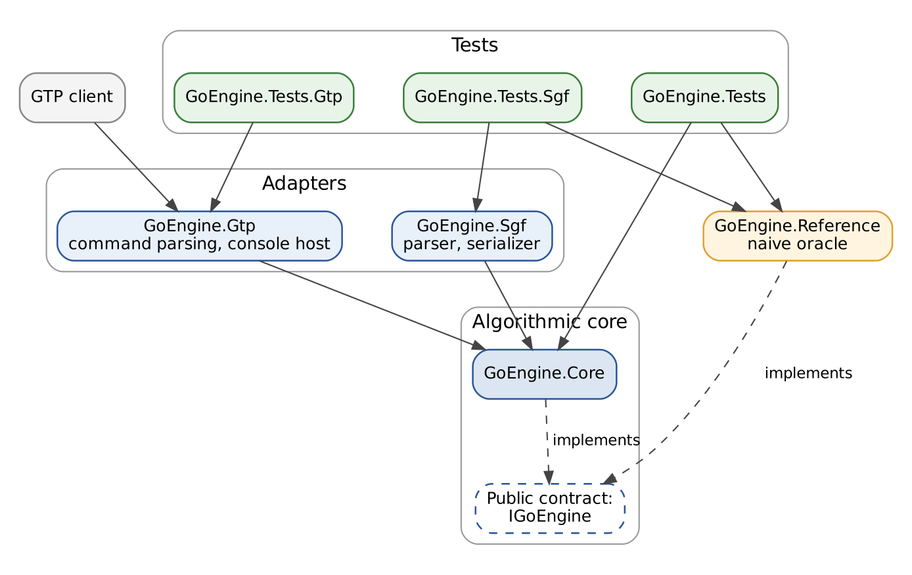

# Design document

**Topic:** Go engine (Tromp-Taylor rules), C#

**Author:** Sofiia Lebedieva, IM-44

> This is an English translation of [`design.md`](design.md). If the two versions differ, the Ukrainian version prevails.

## Contents

1. [Project scope](#1-project-scope)
2. [Domain](#2-domain)
3. [Rule decisions](#3-rule-decisions)
4. [Architecture](#4-architecture)
5. [Invariants and properties](#5-invariants-and-properties)
6. [Testing strategy](#6-testing-strategy)
7. [Test oracle](#7-test-oracle)

## 1. Project scope

### Goal

Develop a library that implements the rules of Go according to the formal Tromp-Taylor specification.

### MVP

- Position model: board, stones, chains (groups) on union-find, liberties.
- Move application: stone placement, capture, suicide check, pass.
- Positional superko on Zobrist hashes.
- Area scoring + komi.
- Move undo and game replay.
- SGF parser and serializer (`FF[4]`), including variations and escaping.
- Basic GTP v2 (console host, no graphical interface).
- Naive oracle implementation and differential tests against the core.
- Exhaustive enumeration on small 3×3 and 4×4 boards (via the internal RuleSet factory).

### Nice to have

- Handicap on standard star points (board sizes 9×9, 13×13, 19×19).
- Manual dead stone marking (via GTP) and scoring that takes it into account.
- Benson's algorithm: finding unconditionally alive chains (pass-alive).

### Out of scope

- Graphical interface (the GTP protocol is used instead of a UI to run as a console application).
- Japanese (territory) scoring and automatic dead stone detection: they have no formal specification and no oracle. Area scoring is in scope instead.
- Rectangular SGF boards (`SZ[19:13]`); only square boards are supported.

## 2. Domain

### Terms

| Term | Definition |
| :---- | :---- |
| Point | An intersection of board lines. Can be empty, black or white. |
| Chain (group) | A maximal set of stones of one colour connected horizontally/vertically (diagonals do not connect). |
| Liberty | An empty point adjacent (in the four directions) to at least one stone of a chain. |
| Capture | Removal from the board of an opponent's chain that has no liberties after a move. |
| Suicide | A move after which the player's own chain has no liberties (provided the move captured nothing). |
| Ko / superko | A ban on a move that repeats a position that has already occurred. Positional superko compares only the board colouring, without regard to whose turn it is. |
| Pass | Declining to move. Two consecutive passes end the game. |
| Area scoring | A player's score = their stones on the board + empty points from which only their stones are reachable. |
| Komi | Compensation to White for Black's right to move first. |
| Reach | Point A reaches colour X if a stone of colour X can be reached from A through empty points. |
| Handicap | Initial placement of extra black stones before White's first move to even the chances of players of different strength. |
| Star points (hoshi) | Marked points on the board for placing handicap stones (standardised for sizes 9, 13 and 19). |
| Unconditionally alive chain (pass-alive) | A chain of stones of one colour that, according to Benson's algorithm, is guaranteed not to be captured by the opponent under any sequence of their moves. |

### Tromp-Taylor rules

1. Go is played on an N×N square grid. Each point is black, white or empty. Initially all points are empty.
2. Black moves first, then moves alternate.
3. A move is either a pass or a stone placement that does not create a board colouring that has already occurred in the game (positional superko).
4. Stone placement: an empty point is coloured with the player's colour; then the opponent's chains without liberties are removed from the board (in the original, the player's own chains without liberties are removed after that as well).
5. Clearing a colour: all stones of that colour are removed except those connected to an empty point (i.e. having a liberty) directly or through other stones of their colour.
6. The game ends after two consecutive passes.
7. Player's score: a player's final result is calculated as the sum of the number of their stones on the board and the number of empty points that reach only their colour.
8. The winner is the player with the higher final result. When calculating White's final result, the komi compensation value (7.5 points by default) is added to their score. If the final scores are equal, the result is a draw.

Unlike the original Tromp-Taylor rules, where suicide is a legal move, in this project it is forbidden by default, which corresponds to generally accepted tournament regulations. Switching between the original and the modified behaviour is supported as the RuleSet.AllowSuicide setting. Both configurations are tested. Tromp-Taylor rule 2 (alternation) is implemented as the default behaviour. For compatibility with GTP v2 and SGF `FF[4]`, which allow several moves of the same colour in a row, a move or a pass can be made with an explicitly specified colour.

Tromp-Taylor rules: <https://tromp.github.io/go.html>

## 3. Rule decisions

| Question | Decision | Rationale |
| :---- | :---- | :---- |
| Rule set | Tromp-Taylor | Formal and unambiguous; serve as a test oracle. |
| Board size (public) | An integer N from 9 to 19 inclusive | Classic board sizes: 9x9, 13x13, 19x19. The 9-19 range enables boundary value testing and compatibility with GTP/SGF |
| Board size (for tests) | Internal RuleSet factory, 2–19 (InternalsVisibleTo for tests only) | Enables exhaustive enumeration on small boards. The engines accept a ready RuleSet and do not check the size, so the public API boundary is defined only by the public RuleSet factory. |
| Suicide | Forbidden by default; AllowSuicide setting | Ensures compatibility with generally accepted tournament regulations and allows flexible switching to the original Tromp-Taylor. |
| Ko | Positional superko | Includes simple ko; matches Tromp-Taylor. |
| Scoring | Area scoring + komi (7.5 by default, configurable) | Does not require determining dead stones. |
| End of game | Two consecutive passes, regardless of their colours | Tromp-Taylor standard. |
| Pass | Always allowed, except in a finished game (GameOver) | Does not violate superko because it does not change the board colouring. |
| Move colour | By default moves alternate, Black moves first. Play and Pass can be made with an explicit colour, including several times in a row with the same colour. | GTP v2 (play) and SGF `FF[4]` allow moves of the same colour in a row. An explicit colour does not affect capture, suicide, superko or scoring. |
| Move after the game ends | Play and Pass return GameOver and do not change the state; Undo is allowed. | Unambiguous behaviour instead of continuing; undo is needed for the GTP undo command. |
| Move check order | GameOver - OutOfBounds - Occupied - Suicide - Superko; the first violated condition is returned. | A move can violate several rules at once (a single-stone suicide with AllowSuicide recreates the previous position). A fixed order makes the result unambiguous for differential tests. |
| Move selection (genmove) | A random legal move with a fixed seed, except a move to an empty point all of whose neighbours are the player's own stones; if there is no such move - pass. | A mandatory GTP v2 command. |
| Dead stone marking via GTP (nice to have) | A non-standard GTP command that marks a chain as dead. The list of marked stones is returned by a standard protocol command. | GTP v2 has no standard command for setting dead stones. |
| Move undo | Supported as a technical mechanism: undo of the last move (including a pass) with full state restoration | Undo is implemented not as part of the classic game flow (where undo is forbidden) but as a technical mechanism for the undo command described in GTP v2. Undo is also used in tests for mathematical proof of the correctness of history preservation. |
| Handicap (nice to have) | Only for sizes 9, 13, 19 (on standard star points) | Star point placement is standardised only for traditional board sizes and is not defined for arbitrary sizes. |
| Dead stones | Automatic detection is not implemented; all stones on the board are considered alive. Nice to have: Benson's algorithm | Full automatic dead stone detection has no formal oracle. Benson's algorithm is considered as an option because it allows unconditionally alive chains to be determined mathematically precisely. |
| Hashing | Zobrist, 64 bits | Fast superko check; possible hash collisions are controlled by differential testing against the oracle. |
| Game format | SGF `FF[4]`, square boards only | The generally accepted format for storing Go games (Smart Game Format). |
| Interface | GTP v2 (text I/O stream) | A standard protocol; replaces the UI. |

## 4. Architecture

### Solution structure

| Project | Purpose |
| :---- | :---- |
| GoEngine.Core | Algorithmic core. Board, Point, Color, Move, RuleSet, GameState, groups (union-find), Zobrist, Superko, Scoring. Optional: Benson, DeadStoneMarker, Handicap. |
| GoEngine.Sgf | Lexer, SGF tree parser, serializer, transfer of a game into GameState and back. Part of the MVP. |
| GoEngine.Gtp | Command parsing, dispatcher, response formatting, console host. Not part of the core. |
| GoEngine.Reference | Naive oracle: full flood fill after every move, storing full positions instead of hashes. Accepts a RuleSet (without size checks). Has public loading of an arbitrary position for exhaustive enumeration. Used by tests only. |
| GoEngine.Tests | Unit, property-based (FsCheck), metamorphic, differential, exhaustive and performance tests. |
| GoEngine.Tests.Sgf / .Gtp | Fuzzing and round-trip for SGF; scenario and contract tests for GTP; performance tests of the adapters. |

### Key principles

- **Single contract.** The IGoEngine interface (Play and Pass with or without an explicit colour, Undo, Score, position snapshot, chain and liberty queries for a point) is implemented by both Core and Reference. The position hash and the superko history are implementation details of Core and are not part of the contract; they are checked by Core's internal tests.
- **Core does not depend on Reference, Sgf or Gtp.** Dependencies point inwards: Gtp and Sgf use Core. Reference depends only on Core's public contract (IGoEngine, Point, Color, RuleSet, MoveResult), and Core's implementation classes have the internal modifier.
- **Immutable position snapshots**, so that tests can compare states by value. Undo is implemented with a per-move change journal rather than by storing snapshots: this gives undo in O(number of changes) instead of O(N²).
- **Errors as values.** An illegal move returns a typed result (Occupied, Suicide, Superko, OutOfBounds, GameOver) rather than an exception: this makes it easier to check atomicity, i.e. that a rejected move does not change the state.
- **Full determinism and isolation.** The result depends only on the RuleSet and the sequence of calls: the engine does not use system time or randomness without a fixed seed (Zobrist keys and genmove are generated from a fixed seed). Each engine instance has its own state and there is no global mutable state, so tests do not affect each other and can run in parallel.
- **Separate assemblies for testing.** Each project has its own coverage and Mutation Score targets. Separate assemblies prevent slow GTP scenario tests from slowing down mutation testing of the core.

### Architecture diagram

### Main Core types

| Type | Responsibility |
| :---- | :---- |
| Board | Array of points, size, neighbours, colouring; cloning and value comparison. |
| GroupTracker | Union-find over chains, incremental liberty tracking, merging chains when a stone is placed and removing a whole chain on capture. All changes of a move are recorded in a journal, and undo rolls them back in reverse order. |
| MoveResolver | Move algorithm: validation, placement, capture of the opponent's chains, suicide check, superko check. |
| ZobristTable / PositionHash | Random keys (with a fixed seed), incremental hash update. |
| SuperkoHistory | Occurrence counter of hashes that have occurred, undo support. |
| AreaScorer | Reachability search over empty regions and score calculation with komi. |
| GameState | Turn, pass counter, captures, history, game-over status. |
| RuleSet | Size, komi, AllowSuicide. |
| BensonAnalyzer (NTH) | Finding unconditionally alive chains via vital regions. |
| DeadStoneMarker (NTH) | Removing marked chains before scoring; validating the marking. |
| Handicap (NTH) | Placing handicap stones according to the star point table. |

## 5. Invariants and properties

The table lists the invariants and properties of the system's core logic that are guaranteed for any legal board state and move. They serve as the specification for property-based testing (FsCheck) and differential testing.

| Layer | Property | Testing technique |
| :---- | :---- | :---- |
| Move | After any legal move (with suicide forbidden) there is no chain without liberties on the board. | Property-based |
| Move | Number of stones on the board = number placed - number removed. | Property-based |
| Move | A move to an occupied point or outside the board is rejected. If a move violates several rules, the first reason in the order GameOver - OutOfBounds - Occupied - Suicide - Superko is returned. | Unit, boundary |
| Move | A rejected move does not change the state (atomicity). | Property-based |
| Move | Play and Pass without an explicit colour are made by the colour whose turn it is; after any move or pass the turn passes to the colour opposite to the one that moved. | Unit, property |
| Move | At the protocol level (GTP v2 play, SGF `FF[4]`) the move colour can be set explicitly, so several moves of the same colour in a row are possible; the game rules do not change, and decisions on capture, suicide and superko do not depend on it. | Unit, differential |
| Move | The opponent's stones are removed first, then suicide is checked: a move that captures a chain and frees liberties is legal. | Scenario, mutation |
| Undo | Undo after Play or Pass returns a state equal to the original: colouring, turn, pass counter, captures, hash and superko history. The turn is restored from the journal, not from the colour of the last stone. | Property-based |
| Groups | Chains and liberties from union-find match a naive flood fill. | Differential |
| Groups | Incremental liberty counting equals a full recount. | Property-based |
| Superko | The incremental hash equals the hash computed from scratch. | Property-based |
| Superko | A move that recreates any previously seen colouring is rejected; the decision matches the oracle. | Differential, scenario |
| Superko | A pass does not change the colouring and does not violate superko. | Unit |
| Scoring | Black's score + White's score + neutral points = N². | Property-based |
| Scoring | The result of a move and of scoring is invariant under the 8 board symmetries. | Metamorphic |
| Scoring | Swapping colours swaps the players' scores (adjusted for komi and turn). | Metamorphic |
| Scoring | Empty board: score 0:0, komi decides the winner. | Unit |
| Scoring | An empty region that touches stones of both colours (or of neither) is neutral and is not counted for anyone. | Unit, metamorphic |
| SGF | parse(write(game)) equals the original game. | Round-trip, property |
| SGF | On arbitrary input the parser throws only SgfParseException, does not fail otherwise and does not hang. | Fuzzing |
| SGF | Escaping (`\]` and `\\`), compound properties and nested variations are handled correctly. | Boundary, unit |
| SGF | Replaying a game from SGF gives the same position as playing the same moves manually. | Metamorphic |
| GTP | Every command gets a response of the form "= ..." or "? ..." with a terminating empty line. | Contract |
| GTP | boardsize outside the 9-19 range returns "unacceptable size"; valid values are accepted. | Boundary |
| GTP | An unknown command and invalid arguments do not break the session. | Scenario, fuzzing |
| GTP | If a command has a numeric id, the response (both success and error) starts with `=id` or `?id`. | Contract |
| Game | The game ends exactly after two consecutive passes (regardless of their colours); any move between passes resets the counter. After the end, Play and Pass return GameOver and do not change the state. | Unit, property |
| Size | The public API rejects 8 and 20, accepts 9 and 19, and all values 10-18 behave the same. | Boundary, mutation |
| Benson (NTH) | A chain recognised as unconditionally alive cannot be captured by any sequence of the opponent's moves (enumeration on small boards). | Exhaustive enumeration |
| Benson (NTH) | The result does not depend on the order in which chains are processed and is invariant under board symmetries. | Property, metamorphic |
| Marking (NTH) | Marking applies to a whole chain; mixed or empty marking is rejected. | Unit, property |
| Marking (NTH) | Scoring with marking equals scoring the board from which these stones have been physically removed. | Differential |
| Handicap (NTH) | The number and positions of stones match the table; after the handicap White moves first. | Unit, boundary |

This list is open and extensible: during development every boundary case or defect found will extend the specification with a new property or a regression test.

## 6. Testing strategy

### Techniques by component

| Layer | Component | Techniques | Tools |
| :---: | :---- | :---- | :---- |
| GoEngine.Core | Groups and liberties | Differential (union-find vs flood fill), property-based | xUnit, FsCheck |
| GoEngine.Core | Move and capture | Unit scenarios, property-based, exhaustive enumeration on small boards, mutation testing | xUnit, FsCheck, Stryker.NET |
| GoEngine.Core | Superko | Ko scenario positions, differential against an oracle with full positions, incremental hash vs recomputation | xUnit, FsCheck |
| GoEngine.Core | Scoring | Reference positions, metamorphic tests (symmetries, colour swap) | xUnit, FsCheck |
| GoEngine.Sgf | SGF | Round-trip, fuzzing, format boundary cases, corpus of real files | FsCheck generators, xUnit |
| GoEngine.Gtp | GTP | Scenario scripts, response format contract tests, input errors | xUnit |
| GoEngine.Core | Performance | Performance tests: warm-up, median, time ratios for different input sizes; separate category | xUnit, Stopwatch |
| GoEngine.Sgf, GoEngine.Gtp | Performance | Performance tests on large inputs (game record, command sequence) | xUnit, Stopwatch |
| GoEngine.Core | Nice to have: Benson, marking | Exhaustive enumeration on small boards, unit, property-based | xUnit, FsCheck |

### Metric targets

Coverage is measured with Coverlet, reports are produced with ReportGenerator, and the tests' ability to detect defects is assessed with mutation testing in Stryker.NET. Target values: core line and branch coverage of at least 90%, core mutation score of at least 85%, a bug-lab of at least 15 defects. Basic performance tests are run separately and must meet the acceptance criteria given in the "Performance tests" subsection.

### Exhaustive testing on small boards

3×3 and 4×4 boards are created through the internal RuleSet factory. For 3×3 boards, full exhaustive testing is performed in the fast cycle: all 3^9 = 19 683 colourings are enumerated. Colourings that contain a chain without liberties are skipped because they are unreachable in a game. Each colouring is loaded into both engines as the first superko history entry, after which moves to every point and a pass are enumerated for both colours, and the result of Core is compared with Reference (MoveResult, captures, colouring, chains and liberties).

For 4×4 boards (3^16 ≈ 43 million colourings) a full exhaustive enumeration algorithm will also be implemented. However, because it is resource-intensive, this test will be isolated in a separate category (run on demand) so that it is not executed on every code change and does not block the regular development process. In the fast everyday cycle and for mutation testing, a representative sample of 4×4 board states is used through a property-based approach. For superko logic, all move sequences up to a given depth are enumerated.

### Managing mutation testing time

To optimise the time of resource-intensive mutation testing without losing quality, the project applies a redundancy-elimination strategy that avoids unnecessarily duplicating checks for every generated "mutant".

The engine's core logic (stone capture algorithms, liberty counting, superko checks) is scale-independent. This means that mutations in the core's basic operators will be detected just as effectively on a 5×5 board as on 19×19. Since it is enough for at least one test to fail to "kill" a mutant, Stryker.NET uses only the optimised fast suite: unit scenarios, small boards and short games.

Heavy property-based tests (long games on 13×13 and 19×19, as well as exhaustive enumeration) remain in the overall test base but are moved to a separate category and are not run for every mutant.

In addition, to ensure stable and reproducible test results, the initial value (seed) of the FsCheck random data generators is fixed. This guarantees that mutation analysis does not depend on randomness (flaky tests), and the number of runs is parameterised for flexible balancing between speed and depth of checking.

### Bug-lab

Bug-lab is a set of at least 15 defects deliberately introduced into the code. Its purpose is to assess not code coverage but the tests' ability to catch specific logical errors and to reveal gaps that are not visible through coverage and mutation score. A defect is considered detected if at least one test fails after it is introduced; surviving defects become a reason to write more tests.

| № | Defect | Expected test |
| :---- | :---- | :---- |
| 1 | Suicide is checked before the opponent's stones are removed | Scenario |
| 2 | Liberties are counted as a list of "stone-point" pairs rather than a set of unique empty points | Differential, property |
| 3 | On capture, the hash is updated with the key of the wrong colour | Property |
| 4 | Superko is not checked for a move with a capture | Ko scenario, differential |
| 5 | The SGF serializer escapes "`]`" but not "`\`" | Round-trip, boundary |
| 6 | Size range mismatch: GTP boardsize accepts 5-25, while RuleSet allows 9-19 | Boundary |
| 7 | Undo removes from the superko history a hash that also occurred earlier (a set instead of a counter) | Property |
| 8 | Undo of a pass restores the turn from the colour of the last stone | Property, unit |
| 9 | A rejected (illegal) move resets the pass counter | Property, unit |
| 10 | Komi is added to Black instead of White | Metamorphic, unit |
| 11 | A region touching both colours is credited to the first colour found | Unit, metamorphic |
| 12 | Chain merging skips one of the neighbours | Differential |
| 13 | The capture counter is incremented by 1 per chain rather than for every removed stone | Property |
| 14 | The SGF parser loses variations nested deeper than 1 level | Round-trip |
| 15 | GTP loses the command id in an error response | Contract |
| 16 | After every move, chains and liberties are rebuilt by a full flood fill of the whole board instead of an incremental union-find update | Performance: move series |
| 17 | Stones of a captured chain are removed from the chain's member list one by one (List.Remove), which gives quadratic complexity in the chain size | Performance: large chains and captures |
| 18 | SuperkoHistory stores board copies instead of hashes and compares the new position with each previous one | Performance: superko in a long game |
| 19 | AreaScorer starts a separate reachability search from every empty point without marking already processed regions | Performance: scoring |
| 20 | The SGF serializer builds the result by string concatenation (`string +=`) instead of StringBuilder | Performance: SGF |
| 21 | Undo is implemented as clearing the board and replaying the whole game without the last move | Performance: GTP |

The defects were chosen so as not to coincide with typical Stryker mutants (changing an operator or a constant, replacing a condition, removing a call): they reproduce realistic logical errors (order of operations, confused variables, wrong data structure semantics, mismatch between layers).

Defects 16–21 are functionally correct, so ordinary tests do not detect them; they are detected only by performance tests.

### Performance tests

The project uses a small set of basic performance tests to check speed. Their purpose is to detect noticeable performance degradation after changes in the implementation of the core and the adapters, when the result remains correct but the execution time grows significantly. The project implements acceptance criteria as time ratios for different input sizes, so they do not depend on the speed of a particular machine.

| Scenario | Description | Metric | Acceptance criterion | Tools |
| :---- | :---- | :---- | :---- | :---- |
| Move series | A game generated with a fixed seed on 9×9, 13×13 and 19×19 boards; the same move sequence is fed into Core and Reference. | Average time per move | Move time hardly depends on board size: t(19)/t(9) ≤ 2. On a 19×19 board Core is at least 10 times faster than Reference. | xUnit, Stopwatch |
| Large chains and captures | Building and capturing a chain that occupies almost the whole board on 9×9 and 19×19 boards; only the capturing move is measured. | Chain capture time | Growth no worse than O(N²): t(19)/t(9) ≤ 6. | xUnit, Stopwatch |
| Superko in a long game | A move on a 19×19 board with 100 and 1000 previous positions in the history. | Average move time | Move time does not grow with game length: t(1000)/t(100) ≤ 2. | xUnit, Stopwatch |
| Scoring | AreaScorer on an empty board, a filled board and a board with many small regions, N = 9, 13, 19. | Average scoring time | Growth no worse than O(N²): t(19)/t(9) ≤ 6. | xUnit, Stopwatch |
| SGF | Parsing and serializing a game record of 1000 and 2000 moves. | Parsing and serialization time | Linear growth with a margin: t(2000)/t(1000) ≤ 3. | xUnit, Stopwatch |
| GTP | Processing a command sequence (play, undo) of 1000 and 2000 commands generated from a game with a fixed seed. | Sequence processing time | Linear growth with a margin: t(2000)/t(1000) ≤ 3. | xUnit, Stopwatch |

**Measurement method.** The tests are implemented as xUnit tests with the category `[Trait("Category", "Performance")]`; time is measured with System.Diagnostics.Stopwatch. Each measurement is performed in the Release configuration after a warm-up, and the result is the median of 7 runs (the number of runs is parameterised). Tests in this category run sequentially (without parallelisation).

**Threshold rationale.** For O(N²) the theoretical ratio is (19/9)² ≈ 4.5, for linear dependence – 2, for almost constant time – 1. The thresholds 6, 3 and 2 respectively leave a margin for measurement noise.

**Move series.** The threshold t(19)/t(9) ≤ 2 distinguishes an incremental implementation (union-find with liberty counting) from a naive full board traversal on every move, and the comparison with Reference in the same test confirms the practical benefit of the chosen approach.

**Superko.** The time of the whole Play call is measured, not of the internal SuperkoHistory class, so the test depends only on the public IGoEngine contract.

**SGF and GTP.** The SGF parser and serializer only process text without checking move legality, so files of 1000 and 2000 moves can be generated synthetically. The genmove command is excluded from the GTP sequence because move selection time depends on the search algorithm, not on the command processing we measure.

Performance tests are placed in the corresponding test projects (GoEngine.Tests, GoEngine.Tests.Sgf, GoEngine.Tests.Gtp) and run on demand with the command `dotnet test -c Release --filter "Category=Performance"`. They are not part of the fast cycle or of Stryker.NET mutation testing because they are long-running, and time measurement depends on machine load.

## 7. Test oracle

**Reference implementation GoEngine.Reference.** The project will develop a separate naive implementation of the Go rules that serves as the main automatic oracle. It consists of a separate GoEngine.Reference project that implements the same IGoEngine interface as the core.

The implementation is built on the principle of maximum algorithmic simplicity: instead of highly efficient data structures (union-find, incremental Zobrist hashes), a direct full flood fill of the whole board and comparison of full matrix position states are performed. Although this approach is computationally slow due to higher time complexity, it is justified from a reliability standpoint because it completely rules out accumulated errors of a mutable graph or hash function collisions.

The advantage of this implementation is that it differs from the core in its algorithms, and its simplicity makes it the least likely place for an error. This will enable differential testing: the same sequence of moves is fed into both implementations, and after every move the move result, board colouring, chains and liberties, capture counters, superko decisions and the final score are compared.

In addition, exhaustive enumeration is performed on small 3×3 and 4×4 boards: for all valid colourings (without chains without liberties) and all possible moves, the core's result is compared with the oracle's result. The oracle's independence is ensured architecturally: Reference uses only the core's public contract, and Core's implementation classes have the internal modifier, so they cannot be borrowed.

**Reference positions according to the Tromp-Taylor specification.** The project will develop a set of positions with manually derived expected results. It consists of scenarios of capturing one and several chains, a capture that frees liberties of the player's own chain, suicide, ko and superko, scoring and a draw. This will allow tests to check the correctness of the oracle itself: both the core and Reference must pass these positions identically. The implementation is based on a small set of unit scenarios, each of which refers to the corresponding rule of the specification.

**Corpus of real games in SGF format.** The corpus consists of two groups of games created outside the project. Computer games are played to the end under rules compatible with those adopted in the project: area scoring, positional superko, forbidden suicide, all stones on the board are considered alive. They are replayed move by move through Core and Reference. The final positions are compared with each other, and the score with komi from the KM property is compared with the `RE[]` result.

Human games are compared only between Core and Reference: final colouring and score. They are not checked against `RE[]` because that result was obtained taking dead stones into account.

The following are excluded from the corpus:

1. games with the setup properties AB, AW, AE;
2. for computer games - also games without a numeric result (win by resignation or on time).

Move illegality is determined only by Reference. On such a move Core must return the same MoveResult as Reference. After that the game is excluded from further replay. The corpus checks the engines on realistic move sequences and at the same time checks the SGF parser.
