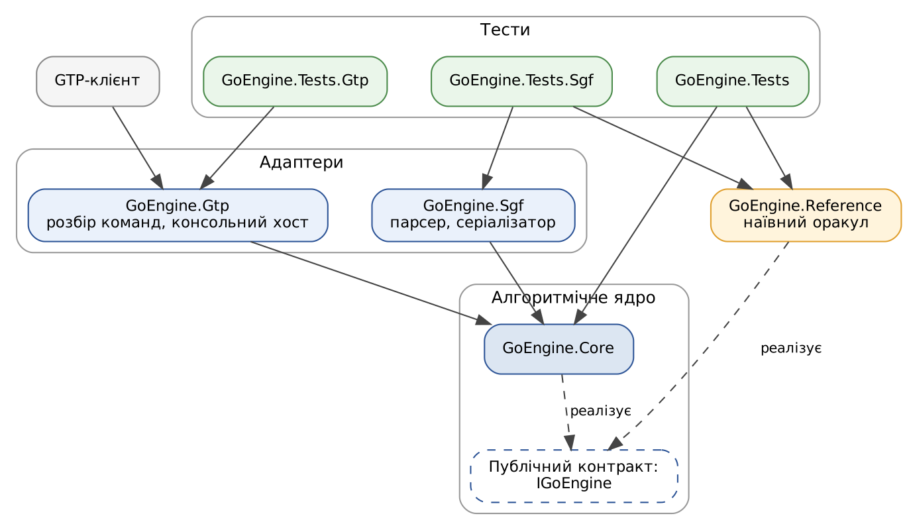

# Дизайн-документ

**Тема:** Рушій гри Го (Tromp-Taylor), C#

**Автор:** Лебедєва Софія, ІМ-44

## Зміст

1. [Межі проєкту](#1-межі-проєкту)
2. [Предметна область](#2-предметна-область)
3. [Прийняті рішення щодо правил](#3-прийняті-рішення-щодо-правил)
4. [Архітектура](#4-архітектура)
5. [Інваріанти та властивості](#5-інваріанти-та-властивості)
6. [Стратегія тестування](#6-стратегія-тестування)
7. [Тестовий оракул](#7-тестовий-оракул)

## 1. Межі проєкту

### Мета

Розробити бібліотеку, що реалізує правила гри Го за формальною специфікацією Tromp-Taylor.

### MVP

- Модель позиції: дошка, камені, ланцюги (групи) на union-find, дихання.
- Застосування ходу: постановка каменя, захоплення, перевірка самогубства, пас.
- Positional superko на хешах Зобриста.
- Підрахунок за площею (area scoring) + комі.
- Відкат ходів (undo) і відтворення партії.
- Парсер і серіалізатор SGF (`FF[4]`), включно з варіаціями та екрануванням.
- Базовий GTP v2 (консольний хост, без графічного інтерфейсу).
- Наївна реалізація-оракул і differential-тести проти ядра.
- Вичерпний перебір на малих дошках 3×3 і 4×4 (через внутрішню фабрику RuleSet).

### Nice to have

- Гандикап за стандартними зоряними точками (розміри дошки 9×9, 13×13, 19×19).
- Ручна розмітка мертвих каменів (через GTP) і підрахунок з її урахуванням.
- Алгоритм Бенсона: пошук безумовно живих ланцюгів (pass-alive).

### Поза межами проєкту

- Графічний інтерфейс (замість UI використовується протокол GTP для роботи як консольного застосунку).
- Японський підрахунок (за територією) та автоматичне визначення мертвих каменів: для них немає формальної специфікації й оракула. Натомість підрахунок за площею входить у проєкт.
- Прямокутні дошки SGF (`SZ[19:13]`); підтримуються лише квадратні.

## 2. Предметна область

### Терміни

| Термін | Визначення |
| :---- | :---- |
| Пункт (точка) | Перетин ліній дошки. Може бути порожнім, чорним або білим. |
| Ланцюг (група) | Максимальна множина каменів одного кольору, з'єднаних по горизонталі/вертикалі (діагоналі не з'єднують). |
| Дихання | Порожній пункт, сусідній (за чотирма напрямками) хоча б з одним каменем ланцюга. |
| Захоплення | Зняття з дошки ланцюга суперника, що після ходу залишився без дихань. |
| Самогубство | Хід, після якого власний ланцюг залишається без дихань (за умови, що хід нічого не захопив). |
| Ко / суперко | Заборона ходу, що повторює позицію, яка вже траплялася. Positional superko порівнює лише розфарбування дошки, без урахування черги ходу. |
| Пас | Відмова від ходу. Два паси поспіль завершують партію. |
| Area scoring | Очки гравця = його камені на дошці + порожні пункти, з яких досяжні лише його камені. |
| Комі | Компенсація білим за право першого ходу в чорних. |
| Досяжність (reach) | Пункт A досягає кольору X, якщо з A можна дійти до каменя кольору X через порожні пункти. |
| Гандикап | Початкове розміщення додаткових чорних каменів до першого ходу білих для вирівнювання шансів гравців різної сили. |
| Зоряні точки (hoshi) | Визначені мітками пункти на дошці для розміщення каменів гандикапу (стандартизовані для розмірів 9, 13 та 19). |
| Безумовно живий ланцюг (pass-alive) | Ланцюг каменів одного кольору, який за алгоритмом Бенсона гарантовано не може бути захоплений супротивником за будь-якої його послідовності ходів. |

### Правила Tromp-Taylor

1. Гра йде на квадратній сітці N×N. Кожен пункт чорний, білий або порожній. Спочатку всі порожні.
2. Першими ходять чорні, далі ходи чергуються.
3. Хід: або пас, або постановка каменя, що не створює розфарбування дошки, яке вже траплялося в партії (positional superko).
4. Постановка каменя: порожній пункт фарбується в колір гравця; потім з дошки знімаються ланцюги суперника без дихань (в оригіналі після цього знімаються й власні ланцюги без дихань).
5. Зняття кольору: прибираються всі камені цього кольору, крім тих, що пов'язані з порожнім пунктом (тобто мають дихання) прямо або через інші камені свого кольору.
6. Партія закінчується після двох пасів поспіль.
7. Очки гравця: підсумковий результат гравця обчислюється як сума кількості його каменів на дошці та кількості порожніх пунктів, що досягають лише його кольору.
8. Переможцем оголошується гравець, чий підсумковий результат є більшим. При обчисленні підсумкового результату білого гравця до його очок додається компенсаційне значення комі (за замовчуванням 7.5 очок). У разі рівності фінальних очок, результат вважається нічиєю.

На відміну від оригінальних правил Tromp-Taylor, де самогубство є дозволеним ходом, у цьому проєкті за замовчуванням воно є забороненим, що відповідає загальноприйнятим турнірним регламентам. Перемикання між оригінальною поведінкою і модифікованою підтримується як налаштування RuleSet.AllowSuicide. Обидві конфігурації тестуються. Правило 2 Tromp-Taylor (чергування) реалізоване як поведінка за замовчуванням. Для сумісності з GTP v2 і SGF `FF[4]`, які допускають кілька ходів одного кольору поспіль, хід або пас можна виконати з явно вказаним кольором.

Правила Tromp-Taylor: <https://tromp.github.io/go.html>

## 3. Прийняті рішення щодо правил

| Питання | Рішення | Обґрунтування |
| :---- | :---- | :---- |
| Набір правил | Tromp-Taylor | Формальні, однозначні, слугують тестовим оракулом. |
| Розмір дошки (публічний) | Ціле число N від 9 до 19 включно | Класичні розміри дошок для гри: 9х9, 13х13, 19х19. Діапазон 9-19 забезпечує тестування граничних значень та сумісність із GTP/SGF |
| Розмір дошки (для тестів) | Внутрішня фабрика RuleSet, 2–19 (InternalsVisibleTo лише для тестів) | Дозволяє вичерпний перебір на малих дошках. Рушії приймають готовий RuleSet і розмір не перевіряють, тому межу публічного API задає лише публічна фабрика RuleSet. |
| Самогубство | Заборонене за замовчуванням; налаштування AllowSuicide | Забезпечує сумісність із загальноприйнятими турнірними регламентами та реалізує гнучке перемикання на оригінальний Tromp-Taylor. |
| Ко | Positional superko | Включає просте ко, відповідає Tromp-Taylor. |
| Підрахунок | Area scoring + комі (за замовчуванням 7.5, настроюване) | Не потребує визначення мертвих каменів. |
| Кінець партії | Два паси поспіль, незалежно від їхніх кольорів | Стандарт Tromp-Taylor. |
| Пас | Завжди допустимий, крім завершеної партії (GameOver) | Не порушує superko, бо не змінює розфарбування дошки. |
| Колір ходу | За замовчуванням ходи чергуються, першими ходять чорні. Play і Pass можна виконати з явним кольором, зокрема кілька разів поспіль одним кольором. | GTP v2 (play) і SGF `FF[4]` допускають ходи одного кольору поспіль. Явний колір не впливає на захоплення, самогубство, superko і підрахунок. |
| Хід після завершення партії | Play і Pass повертають GameOver і не змінюють стан; Undo дозволений. | Однозначна поведінка замість продовження; undo потрібен для команди GTP undo. |
| Порядок перевірок ходу | GameOver - OutOfBounds - Occupied - Suicide - Superko; повертається перша порушена умова. | Хід може порушувати кілька правил одночасно (самогубство одного каменя за AllowSuicide відтворює попередню позицію). Фіксований порядок робить результат однозначним для differential-тестів. |
| Вибір ходу (genmove) | Випадковий легальний хід із фіксованим seed, крім ходу в порожній пункт, усі сусіди якого - камені власного кольору; якщо такого ходу немає - пас. | Обов'язкова команда GTP v2. |
| Розмітка мертвих каменів через GTP (nice to have) | Нестандартна GTP-команда, яка позначає ланцюг мертвим. Список позначених каменів повертає стандартна команда протоколу. | GTP v2 не має стандартної команди для встановлення мертвих каменів. |
| Відкат ходів (undo) | Підтримується як технічний механізм: відкат останнього ходу (включно з пасом) з повним відновленням стану | Функція відкату ходів (undo) реалізується не як частина класичного ігрового процесу (де відкати заборонені), а як технічний механізм для команди undo, описаної в GTP v2. Також Undo використовується для математичного доведення коректності збереження історії в тестах. |
| Гандикап (nice to have) | Лише для розмірів 9, 13, 19 (за стандартними зоряними точками) | Розташування зоряних точок стандартизовано виключно для традиційних розмірів дошок і не визначено для довільних розмірностей. |
| Мертві камені | Автовизначення не реалізовано; усі камені на дошці вважаються живими. Nice to have: алгоритм Бенсона | Повне автовизначення мертвих каменів не має формального оракула. Алгоритм Бенсона розглядається як опція, оскільки він дозволяє математично точно визначати безумовно живі ланцюги каменів. |
| Хешування | Zobrist, 64 біти | Швидка перевірка superko; можливі колізії хешів контролюються диференціальним тестуванням з оракулом. |
| Формат партій | SGF `FF[4]`, лише квадратні дошки | Загальноприйнятий формат збереження партій Го (Smart Game Format). |
| Інтерфейс | GTP v2 (текстовий потік I/O) | Стандартний протокол, замінює UI. |

## 4. Архітектура

### Структура рішення

| Проєкт | Призначення |
| :---- | :---- |
| GoEngine.Core | Алгоритмічне ядро. Board, Point, Color, Move, RuleSet, GameState, групи (union-find), Zobrist, Superko, Scoring. Опційно: Benson, DeadStoneMarker, Handicap. |
| GoEngine.Sgf | Лексер, парсер дерева SGF, серіалізатор, перенесення партії в GameState і назад. Входить в MVP. |
| GoEngine.Gtp | Розбір команд, диспетчер, форматування відповідей, консольний хост. Не входить в ядро. |
| GoEngine.Reference | Наївний оракул: повний flood fill після кожного ходу, зберігання повних позицій замість хешів. Приймає RuleSet (без перевірки розміру). Має публічне завантаження довільної позиції для вичерпного перебору. Використовується лише тестами. |
| GoEngine.Tests | Unit, property-based (FsCheck), метаморфічні, differential, вичерпні тести, performance-тести. |
| GoEngine.Tests.Sgf / .Gtp | Fuzzing і round-trip для SGF; сценарні та контрактні тести для GTP; performance-тести адаптерів. |

### Ключові принципи

- **Єдиний контракт.** Інтерфейс IGoEngine (Play і Pass з явним кольором або без нього, Undo, Score, знімок позиції, запити ланцюга й дихань пункту) реалізують і Core, і Reference. Хеш позиції та історія superko - деталі реалізації Core і до контракту не входять; їх перевіряють internal-тести Core.
- **Core не залежить від Reference, Sgf і Gtp.** Залежності спрямовані досередини: Gtp і Sgf використовують Core. Reference залежить лише від публічного контракту Core (IGoEngine, Point, Color, RuleSet, MoveResult), а реалізаційні класи Core мають модифікатор internal.
- **Іммутабельні знімки позиції**, щоб тести могли порівнювати стани за значенням. Undo реалізується журналом змін ходу, а не зберіганням знімків: це дає відкат за O(кількість змін) замість O(N²).
- **Помилки як значення.** Нелегальний хід повертає типізований результат (Occupied, Suicide, Superko, OutOfBounds, GameOver), а не виняток: так простіше перевіряти атомарність, коли відхилений хід не змінює стан.
- **Повна детермінованість та ізоляція.** Результат залежить лише від RuleSet і послідовності викликів: рушій не використовує системний час чи випадковість без фіксованого seed (Zobrist-ключі та genmove генеруються з фіксованого зерна). Кожен екземпляр рушія має власний стан, глобального змінюваного стану немає, тому тести не впливають один на одного й можуть виконуватися паралельно.
- **Окремі збірки для тестування.** Кожен проєкт має власні цілі покриття та Mutation Score. Окремі збірки запобігають сповільненню мутаційного тестування ядра повільними сценарними тестами GTP.

### Діаграма архітектури

### Основні типи Core

| Тип | Відповідальність |
| :---- | :---- |
| Board | Масив пунктів, розмір, сусіди, розфарбування; клонування та порівняння за значенням. |
| GroupTracker | Union-find за ланцюгами, інкрементальний облік дихань, злиття ланцюгів під час постановки каменя та видалення цілого ланцюга під час захоплення. Усі зміни ходу записуються в журнал, і undo відкочує їх у зворотному порядку. |
| MoveResolver | Алгоритм ходу: валідація, постановка, захоплення ланцюгів суперника, перевірка самогубства, перевірка superko. |
| ZobristTable / PositionHash | Випадкові ключі (з фіксованим seed), інкрементальне оновлення хешу. |
| SuperkoHistory | Лічильник входжень хешів, що траплялися, підтримка відкату. |
| AreaScorer | Пошук досяжності порожніх областей і підрахунок очок з комі. |
| GameState | Черга ходу, лічильник пасів, захоплення, історія, статус завершення. |
| RuleSet | Розмір, комі, AllowSuicide. |
| BensonAnalyzer (NTH) | Пошук безумовно живих ланцюгів через життєві області (vital regions). |
| DeadStoneMarker (NTH) | Зняття розмічених ланцюгів перед підрахунком; валідація розмітки. |
| Handicap (NTH) | Розстановка гандикапних каменів за таблицею зоряних точок. |

## 5. Інваріанти та властивості

Таблиця містить інваріанти та властивості системи з базової логіки, які гарантуються на будь-яких легальних станах дошки та ходах. Вони слугують специфікацією для Property-Based тестування (FsCheck) та Differential Testing.

| Шар | Властивість | Техніка тестування |
| :---- | :---- | :---- |
| Хід | Після будь-якого легального ходу (за забороненого самогубства) на дошці немає ланцюга без дихань. | Property-based |
| Хід | Кількість каменів на дошці = кількість поставлених - кількість знятих. | Property-based |
| Хід | Хід на зайнятий пункт або за межі дошки відхиляється. Якщо хід порушує кілька правил, повертається перша причина в порядку GameOver - OutOfBounds - Occupied - Suicide - Superko. | Unit, boundary |
| Хід | Відхилений хід не змінює стан (атомарність). | Property-based |
| Хід | Play і Pass без явного кольору виконуються кольором, чия черга; після будь-якого ходу чи пасу черга переходить до кольору, протилежного тому, що походив. | Unit, property |
| Хід | На рівні протоколу (GTP v2 play, SGF `FF[4]`) колір ходу може задаватися явно, тож можливі кілька ходів одного кольору поспіль; ігрові правила не змінюються, і рішення щодо захоплення, самогубства й superko від цього не залежать. | Unit, differential |
| Хід | Спочатку знімаються камені суперника, потім перевіряється самогубство: хід, що захоплює ланцюг і звільняє дихання, легальний. | Сценарні, mutation |
| Undo | Undo після Play або Pass повертає стан, рівний вихідному: розфарбування, черга, лічильник пасів, захоплення, хеш та історія superko. Черга відновлюється з журналу, а не з кольору останнього каменя. | Property-based |
| Групи | Ланцюги та дихання з union-find збігаються з наївним flood fill. | Differential |
| Групи | Інкрементальний підрахунок дихань дорівнює повному перерахунку. | Property-based |
| Superko | Інкрементальний хеш дорівнює хешу, обчисленому з нуля. | Property-based |
| Superko | Хід, що відтворює будь-яке раніше зустрінуте розфарбування, відхиляється; рішення збігається з оракулом. | Differential, сценарні |
| Superko | Пас не змінює розфарбування і не порушує superko. | Unit |
| Підрахунок | Очки чорних + очки білих + нейтральні пункти = N². | Property-based |
| Підрахунок | Результат ходу та підрахунку інваріантний щодо 8 симетрій дошки. | Метаморфічний |
| Підрахунок | Заміна кольорів місцями міняє очки гравців місцями (з поправкою на комі та чергу ходу). | Метаморфічний |
| Підрахунок | Порожня дошка: рахунок 0:0, перемогу визначає комі. | Unit |
| Підрахунок | Порожня область, що торкається каменів обох кольорів (або жодного), нейтральна й не зараховується нікому. | Unit, метаморфічний |
| SGF | parse(write(game)) дорівнює вихідній партії. | Round-trip, property |
| SGF | На довільному вході парсер викидає лише SgfParseException, не падає інакше і не зависає. | Fuzzing |
| SGF | Екранування (`\]` і `\\`), складені властивості, вкладені варіації обробляються коректно. | Граничні, unit |
| SGF | Відтворення партії з SGF дає ту саму позицію, що й ручна гра тими самими ходами. | Метаморфічний |
| GTP | Кожна команда дає відповідь формату "= ..." або "? ..." із завершальним порожнім рядком. | Контрактні |
| GTP | boardsize поза діапазоном 9-19 повертає "unacceptable size"; допустимі значення приймаються. | Boundary |
| GTP | Невідома команда та хибні аргументи не ламають сесію. | Сценарні, fuzzing |
| GTP | Якщо команда має числовий id, відповідь (успішна й помилкова) починається з `=id` або `?id`. | Контрактні |
| Партія | Партія завершується рівно після двох пасів поспіль (незалежно від їхніх кольорів); будь-який хід між пасами скидає лічильник. Після завершення Play і Pass повертають GameOver і не змінюють стан. | Unit, property |
| Розмір | Публічний API відхиляє 8 і 20, приймає 9 і 19, усі значення 10-18 працюють однаково. | Boundary, mutation |
| Бенсон (NTH) | Ланцюг, визнаний безумовно живим, неможливо захопити жодною послідовністю ходів суперника (перебір на малих дошках). | Вичерпний перебір |
| Бенсон (NTH) | Результат не залежить від порядку обробки ланцюгів і інваріантний щодо симетрій дошки. | Property, метаморфічний |
| Розмітка (NTH) | Розмітка діє на ланцюг цілком; змішана або порожня розмітка відхиляється. | Unit, property |
| Розмітка (NTH) | Підрахунок із розміткою дорівнює підрахунку дошки, з якої ці камені фізично зняті. | Differential |
| Гандикап (NTH) | Кількість і позиції каменів відповідають таблиці; після гандикапу першими ходять білі. | Unit, boundary |

Цей перелік є відкритим і розширюваним: у процесі розробки кожен виявлений граничний випадок чи дефект доповнюватиме специфікацію новою властивістю або регресійним тестом.

## 6. Стратегія тестування

### Техніки за компонентами

| Шар | Компонент | Техніки | Інструменти |
| :---: | :---- | :---- | :---- |
| GoEngine.Core | Групи та дихання | Differential (union-find проти flood fill), property-based | xUnit, FsCheck |
| GoEngine.Core | Хід і захоплення | Unit-сценарії, property-based, вичерпний перебір на малих дошках, mutation testing | xUnit, FsCheck, Stryker.NET |
| GoEngine.Core | Superko | Сценарні позиції ко, differential проти оракула з повними позиціями, інкрементальний хеш проти перерахунку | xUnit, FsCheck |
| GoEngine.Core | Підрахунок очок | Еталонні позиції, метаморфічні тести (симетрії, заміна кольорів) | xUnit, FsCheck |
| GoEngine.Sgf | SGF | Round-trip, fuzzing, граничні випадки формату, корпус реальних файлів | FsCheck-генератори, xUnit |
| GoEngine.Gtp | GTP | Сценарні скрипти, контрактні тести формату відповідей, помилки вводу | xUnit |
| GoEngine.Core | Продуктивність | Performance-тести: прогрів, медіана, співвідношення часу для різних розмірів входу; окрема категорія | xUnit, Stopwatch |
| GoEngine.Sgf, GoEngine.Gtp | Продуктивність | Performance-тести на великих вхідних даних (запис партії, послідовність команд) | xUnit, Stopwatch |
| GoEngine.Core | Nice to have: Бенсон, розмітка | Вичерпний перебір на малих дошках, unit, property-based | xUnit, FsCheck |

### Цілі за метриками

Для вимірювання покриття використовується Coverlet, звіти формуються через ReportGenerator, а здатність тестів виявляти дефекти оцінюється mutation testing у Stryker.NET. Цільові значення: покриття рядків і гілок ядра не нижче 90%, mutation score ядра не нижче 85%, bug-lab не менше ніж із 15 дефектів. Базові performance-тести виконуються окремо й повинні відповідати критеріям прийняття, наведеним у підрозділі «Performance-тести».

### Вичерпне тестування на малих дошках

Через внутрішню фабрику RuleSet створюються дошки 3×3 і 4×4. Для дошок 3×3 виконується повне вичерпне тестування у швидкому циклі: перебираються всі 3^9 = 19 683 розфарбувань. Розфарбування, що містять ланцюг без дихань, пропускаються, бо в партії вони недосяжні. Кожне розфарбування завантажується в обидва рушії як перший запис історії superko, після чого для обох кольорів перебираються ходи в кожен пункт і пас, а результат Core порівнюється з Reference (MoveResult, захоплення, розфарбування, ланцюги й дихання).

Для дошок 4×4 (3^16 ≈ 43 млн розфарбувань) також буде реалізовано алгоритм повного вичерпного перебору. Проте, через високу ресурсомісткість, цей тест буде ізольовано в окрему категорію (для запуску на вимогу), щоб уникнути його виконання при кожній зміні коду та не блокувати регулярний процес розробки. У швидкому повсякденному циклі та для мутаційного тестування дошки 4×4 застосовується репрезентативна вибірка станів через Property-based підхід. Для логіки superko перебираються всі послідовності ходів до заданої глибини.

### Керування часом mutation testing

Щоб оптимізувати час ресурсомісткого мутаційного тестування без втрати якості, у проєкті застосовується стратегія усунення надмірності, яка дозволяє уникнути зайвого дублювання перевірок для кожного згенерованого «мутанта».

Базова логіка рушія (алгоритми захоплення каменів, підрахунок дихань, перевірки Superko) є масштабонезалежною. Це означає, що мутації у базових операторах ядра будуть однаково ефективно виявлені як на дошці 5×5, так і на 19×19. Оскільки для «знищення» мутанта достатньо падіння хоча б одного тесту, для інструмента Stryker.NET використовується виключно оптимізований швидкий набір: unit-сценарії, малі дошки та короткі партії.

Важкі property-based тести (довгі партії на 13×13 та 19×19, а також вичерпний перебір) залишаються в загальній тестовій базі, проте винесені в окрему категорію і не запускаються на кожного мутанта.

Додатково, для забезпечення стабільності та відтворюваності результатів тестування, фіксується початкове значення (seed) генераторів випадкових даних FsCheck. Це гарантує, що мутаційний аналіз не залежатиме від випадковостей (flaky tests), а кількість прогонів параметризується для гнучкого балансування між швидкістю та глибиною перевірки.

### Bug-lab

Bug-lab - це набір щонайменше з 15 свідомо внесених у код дефектів. Його мета - оцінити не покриття коду, а здатність тестів ловити конкретні логічні помилки та виявити прогалини, яких не видно за покриттям і mutation score. Дефект вважається виявленим, якщо після його внесення падає принаймні один тест; дефекти, що вижили, стають приводом дописати тести.

| № | Дефект | Очікуваний тест |
| :---- | :---- | :---- |
| 1 | Самогубство перевіряється до зняття каменів суперника | Сценарний |
| 2 | Дихання рахуються списком пар «камінь-пункт», а не множиною унікальних порожніх пунктів | Differential, property |
| 3 | Хеш при захопленні оновлюється ключем не того кольору | Property |
| 4 | Superko не перевіряється для ходу із захопленням | Сценарний ко, differential |
| 5 | В SGF-серіалізаторі екранується «`]`», але не «`\`» | Round-trip, граничний |
| 6 | Розсинхронізація діапазону розміру: GTP boardsize приймає 5-25, а RuleSet дозволяє 9-19 | Boundary |
| 7 | Undo видаляє з історії superko хеш, що траплявся й раніше (множина замість лічильника) | Property |
| 8 | Undo пасу відновлює чергу ходу за кольором останнього каменя | Property, unit |
| 9 | Відхилений (нелегальний) хід скидає лічильник пасів | Property, unit |
| 10 | Комі додається чорним замість білих | Метаморфічний, unit |
| 11 | Область, що торкається обох кольорів, зараховується першому знайденому кольору | Unit, метаморфічний |
| 12 | Злиття ланцюгів пропускає одного з сусідів | Differential |
| 13 | Лічильник захоплень збільшується на 1 за ланцюг, а не за кожен знятий камінь | Property |
| 14 | SGF-парсер втрачає вкладені варіації глибше 1 рівня | Round-trip |
| 15 | GTP губить id команди у відповіді-помилці | Контрактний |
| 16 | Після кожного ходу ланцюги й дихання перебудовуються повним flood fill усієї дошки замість інкрементального оновлення union-find | Performance: серія ходів |
| 17 | Камені захопленого ланцюга видаляються зі списку членів ланцюга по одному (List.Remove), що дає квадратичну складність від розміру ланцюга | Performance: великі ланцюги та захоплення |
| 18 | SuperkoHistory зберігає копії дошок замість хешів і порівнює нову позицію з кожною попередньою | Performance: superko на довгій партії |
| 19 | AreaScorer запускає окремий пошук досяжності з кожного порожнього пункту, не позначаючи вже оброблені області | Performance: підрахунок очок |
| 20 | SGF-серіалізатор будує результат конкатенацією рядків (`string +=`) замість StringBuilder | Performance: SGF |
| 21 | Undo реалізовано як очищення дошки й повторне відтворення всієї партії без останнього ходу | Performance: GTP |

Дефекти підібрано так, щоб не збігатися з типовими мутантами Stryker (зміна оператора чи константи, підміна умови, видалення виклику): вони відтворюють реалістичні логічні помилки (порядок операцій, плутанина змінних, неправильна семантика структури даних, розбіжність між шарами).

Дефекти 16–21 функціонально коректні, тому звичайні тести їх не виявляють; вони виявляються лише performance-тестами.

### Performance-тести

У проєкті застосовується невеликий набір базових performance-тестів для перевірки швидкодії. Їхня мета – виявлення помітної деградації продуктивності після змін у реалізації ядра та адаптерів, коли результат залишається коректним, а час виконання суттєво зростає. У проєкті реалізовано критерії прийняття у вигляді співвідношення часу для різних розмірів вхідних даних, тому вони не залежать від швидкодії конкретної машини.

| Сценарій | Опис | Метрика | Критерій прийняття | Інструменти |
| :---- | :---- | :---- | :---- | :---- |
| Серія ходів | Партія, згенерована з фіксованим seed, на дошках 9×9, 13×13 та 19×19; та сама послідовність ходів подається в Core і Reference. | Середній час на один хід | Час ходу майже не залежить від розміру дошки: t(19)/t(9) ≤ 2. На дошці 19×19 Core щонайменше в 10 разів швидший за Reference. | xUnit, Stopwatch |
| Великі ланцюги та захоплення | Побудова й захоплення ланцюга, що займає майже всю дошку, на дошках 9×9 і 19×19; вимірюється лише хід захоплення. | Час захоплення ланцюга | Зростання не гірше ніж O(N²): t(19)/t(9) ≤ 6. | xUnit, Stopwatch |
| Superko на довгій партії | Хід на дошці 19×19 за наявності в історії 100 і 1000 попередніх позицій. | Середній час ходу | Час ходу не зростає з довжиною партії: t(1000)/t(100) ≤ 2. | xUnit, Stopwatch |
| Підрахунок очок | AreaScorer на порожній і заповненій дошці та дошці з багатьма дрібними областями, N = 9, 13, 19. | Середній час підрахунку | Зростання не гірше ніж O(N²): t(19)/t(9) ≤ 6. | xUnit, Stopwatch |
| SGF | Розбір і серіалізація запису партії обсягом 1000 і 2000 ходів. | Час розбору та серіалізації | Лінійне зростання з запасом: t(2000)/t(1000) ≤ 3. | xUnit, Stopwatch |
| GTP | Обробка послідовності команд (play, undo) обсягом 1000 і 2000 команд, згенерованої з партії з фіксованим seed. | Час обробки послідовності | Лінійне зростання з запасом: t(2000)/t(1000) ≤ 3. | xUnit, Stopwatch |

**Спосіб вимірювання.** Тести реалізуються як тести xUnit із категорією `[Trait("Category", "Performance")]`, час вимірюється через System.Diagnostics.Stopwatch. Кожне вимірювання виконується в конфігурації Release після прогріву, а результатом вважається медіана 7 прогонів (кількість прогонів параметризується). Тести цієї категорії виконуються послідовно (без паралелізації).

**Обґрунтування порогів.** Для O(N²) теоретичне співвідношення становить (19/9)² ≈ 4,5, для лінійної залежності – 2, для майже сталого часу – 1. Пороги 6, 3 і 2 відповідно залишають запас на шум вимірювання.

**Серія ходів.** Поріг t(19)/t(9) ≤ 2 відрізняє інкрементальну реалізацію (union-find з підрахунком дихань) від наївного повного обходу дошки на кожному ході, а порівняння з Reference у тому самому тесті підтверджує практичну користь обраного підходу.

**Superko.** Вимірюється час усього виклику Play, а не внутрішнього класу SuperkoHistory, тому тест залежить лише від публічного контракту IGoEngine.

**SGF і GTP.** Парсер і серіалізатор SGF лише обробляють текст, не перевіряючи легальність ходів, тому файли обсягом 1000 і 2000 ходів можуть бути згенеровані синтетично. Команду genmove виключено з послідовності GTP, оскільки час вибору ходу залежить від алгоритму його пошуку, а не від обробки команд, які ми вимірюємо.

Performance-тести розміщуються у відповідних тестових проєктах (GoEngine.Tests, GoEngine.Tests.Sgf, GoEngine.Tests.Gtp) і запускаються на вимогу командою `dotnet test -c Release --filter "Category=Performance"`. Вони не входять до швидкого циклу та мутаційного тестування Stryker.NET, оскільки є тривалими, а вимірювання часу залежить від навантаження машини.

## 7. Тестовий оракул

**Еталонна реалізація GoEngine.Reference.** У проєкті буде розроблено окрему наївну реалізацію правил Го, яка слугує основним автоматичним оракулом. Вона складається з окремого проєкту GoEngine.Reference, що реалізує той самий інтерфейс IGoEngine, що й ядро.

Реалізація будується за принципом максимальної алгоритмічної простоти: замість високоефективних структур даних (union-find, інкрементальні хеші Зобриста) виконується прямий повний flood fill усієї дошки та порівняння повних матричних станів позицій. Хоча такий підхід є обчислювально повільним через вищу часову складність, він є обґрунтованим з погляду надійності, оскільки повністю виключає стан накопичуваних помилок мутабельного графу чи колізій хеш-функції.

Перевага цієї реалізації в тому, що вона відрізняється від ядра за алгоритмами, а простота робить її найменш імовірним місцем для помилки. Це дасть для тестів можливість виконувати differential-тестування: однакова послідовність ходів подається в обидві реалізації, і після кожного ходу порівнюються результат ходу, розфарбування дошки, ланцюги й дихання, лічильники захоплень, рішення щодо superko та підсумковий підрахунок очок.

Додатково на малих дошках 3×3 і 4×4 виконується вичерпний перебір: для всіх допустимих розфарбувань (без ланцюгів без дихань) і всіх можливих ходів результат ядра зіставляється з результатом оракула. Незалежність оракула забезпечується архітектурно: Reference використовує лише публічний контракт ядра, а реалізаційні класи Core мають модифікатор internal, тому запозичити їх неможливо.

**Еталонні позиції за специфікацією Tromp-Taylor.** У проєкті буде розроблено набір позицій із вручну виведеними очікуваними результатами. Він складається зі сценаріїв захоплення одного й кількох ланцюгів, захоплення, що звільняє дихання власного ланцюга, самогубства, ко та суперко, підрахунку очок і нічиєї. Це дасть для тестів перевірку правильності самого оракула: і ядро, і Reference мають проходити ці позиції однаково. Реалізація ґрунтується на невеликому наборі unit-сценаріїв, кожен із яких посилається на відповідне правило специфікації.

**Набір реальних партій у форматі SGF.** Корпус складається з двох груп партій, створених поза проєктом. Комп'ютерні партії дограні до кінця за правилами, сумісними з прийнятими в проєкті: підрахунок за площею, positional superko, заборонене самогубство, усі камені на дошці вважаються живими. Вони відтворюються ходами через Core і Reference. Фінальні позиції порівнюються між собою, а підрахунок із комі зі властивості KM порівнюється з результатом `RE[]`.

Людські партії порівнюються лише між Core і Reference: фінальне розфарбування та підрахунок. З `RE[]` їх не звіряють, бо цей результат отримано з урахуванням мертвих каменів.

З корпусу виключаються:

1. партії з властивостями розстановки AB, AW, AE;
2. для комп'ютерних партій - також партії без числового результату (перемога здачею або за часом).

Нелегальність ходу визначає лише Reference. На такому ході Core має повернути той самий MoveResult, що й Reference. Після цього партія виключається з подальшого відтворення. Корпус перевіряє рушії на реалістичних послідовностях ходів і одночасно перевіряє парсер SGF.
